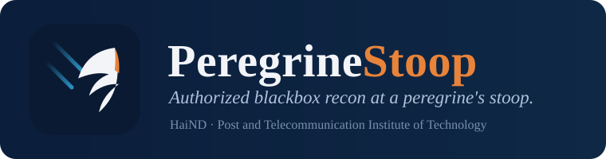

<p align="center">
  
</p>

<p align="center">
  
  
  
  
  
</p>

# PeregrineStoop

> A peregrine's stoop is the fastest hunting move in nature. PeregrineStoop brings that speed to blackbox recon.

**PeregrineStoop** is an authorized blackbox pentest accelerator. It does **not**
add another raw scanner. Instead it *reduces friction between recon steps* so you
spend time on reasoning instead of plumbing. The CLI modules share one state
layer, and **every HTTP request passes through a scope gate and an append-only
audit log**.

* **Author:** HaiND, Post and Telecommunication Institute of Technology
* **CLI:** `stoop` &nbsp;·&nbsp; **Package:** `peregrinestoop`
* **Repo:** https://github.com/Haind03/PeregrineStoop

## Authorization and safety

PeregrineStoop is built for **authorized testing only** (HackerOne, Bugcrowd,
Intigriti, Immunefi, or a signed engagement). It refuses to touch any host that
is not explicitly in scope.

Guardrails that do not bend:

1. **Scope gate.** Every outbound request is checked by `ScopeChecker`.
   `*.target.com` matches `a.target.com` and `target.com`, anchored on the dot,
   so `evil-target.com` does **not** match. Out of scope requests are never sent;
   they raise `ScopeViolation`.
2. **Audit log.** An append only JSONL record for every request attempt (`url`,
   `method`, `scope_check`, `status`, `timestamp`, `session_id`), including the
   blocked ones.
3. **Rate limit** (default 3 req/s), **timeout**, **body size cap**, and a
   **User-Agent that declares authorized testing** (with a contact).
4. **Safe methods by default.** Only `GET`, `HEAD`, `OPTIONS`. The unsafe methods
   `PUT`, `POST`, `DELETE`, `PATCH` require `--allow-unsafe` and print a warning.

There are **no** mass targeting, DoS, or detection evasion features. Confirm a
host is in your authorized scope before pointing PeregrineStoop at it.

## Install

```bash
pip install -e .            # installs the `stoop` entrypoint
pip install -e '.[test]'    # plus pytest and responses (dev only)
```

`requests` is the only **runtime** dependency outside the standard library. The test suite also
uses `responses` (dev only), which is never imported by the package itself.

Detection is **driven by data files**: the fingerprint signatures live in
[`data/signatures.json`](peregrinestoop/data/signatures.json) and the CVE
candidates in [`data/cve_map.json`](peregrinestoop/data/cve_map.json). Both can
be extended without touching code. If a data file is missing or corrupt, that
detector is disabled gracefully rather than crashing.

## Commands

| Command | What it does |
|---------|--------------|
| `stoop fingerprint` | Tech and WAF fingerprint of a single URL. |
| `stoop crawl` | Bounded, scope gated link discovery; seeds from robots.txt and sitemap. |
| `stoop diff` | Snapshot a surface and diff it against a baseline. |
| `stoop run` | Full budgeted pipeline: deep fingerprint, rank, safe probes, report. |
| `stoop probe` | Safe active probes (GET and OPTIONS only). |
| `stoop report` | Render a Markdown or HTML recon report from stored state. |
| `stoop audit` | Summarize the JSONL audit log. |
| `stoop resume` | Show the last session's state. |

## Usage

Scope is mandatory. Supply it inline or from a file.

```bash
# scope file: one pattern per line; '!' excludes, '#' is a comment
# *.target.com
# !admin.target.com
# 10.0.0.0/8
```

```bash
# fingerprint one URL
stoop fingerprint https://app.target.com --scope "*.target.com" --json fp.json

# bounded crawl, writing a snapshot that chains into diff
stoop crawl https://app.target.com --scope "*.target.com" --depth 1 --max-pages 25 --snapshot base.json

# diff a later crawl against the baseline
stoop diff --url-file urls.txt --scope-file scope.txt --baseline base.json --json diff.json

# full pipeline with a time budget
stoop run https://app.target.com --scope "*.target.com" --budget 300 --rate 3 --json run.json

# full pipeline plus a crawl and a saved engagement bundle
stoop run https://app.target.com --scope "*.target.com" --crawl --session-dir out/

# safe active probes
stoop probe https://app.target.com/login --scope "*.target.com" --json probe.json

# reports
stoop report https://app.target.com --out report.md
stoop report https://app.target.com --out report.html

# audit log summary
stoop audit --audit-log stoop_audit.jsonl --json summary.json
```

Config profiles keep per engagement defaults in TOML; CLI flags still override
them:

```toml
# stoop.toml
[scope]
include = ["*.target.com"]
exclude = ["admin.target.com"]

[http]
rate = 2
budget = 600
timeout = 20
```

```bash
stoop run https://app.target.com --config stoop.toml
```

Output convention: **stdout** is machine readable JSON, **stderr** is the human
log and the priority table (colored `[+] [-] [!] [*]`).

## Detection coverage

**Stacks**

* PHP, ASP.NET (Core and Kestrel), Node (Express, Next, Nuxt)
* Java (Tomcat, Jetty, JBoss, WebLogic, WebSphere, GlassFish)
* Python (Django, Flask, Gunicorn, Uvicorn, Daphne), Ruby (Rails, Rack, Passenger)
* ColdFusion, Symfony, Yii, CodeIgniter, Laravel, Spring Boot
* Drupal, Joomla, Magento, WordPress, Angular, React, Vue
* Jenkins, GitLab, Atlassian, Grafana, phpMyAdmin

**WAF and CDN**

* Cloudflare, Akamai, Imperva Incapsula, F5 BIG-IP ASM, AWS CloudFront, AWS WAF
* Sucuri, Fastly, ModSecurity, Wordfence, Barracuda, FortiWeb
* Citrix NetScaler, Azure Front Door, Reblaze, DenyAll, Edgecast

**Vulnerability classes routed for prioritization**

* Injection: sqli, nosqli, ssti, spel, ognl, csti
* Files: lfi, path traversal, upload
* Logic and data: idor, mass assignment, deserialization, ssrf, xxe, proto pollution
* Platform: viewstate, padding oracle, debug and actuator leaks, dangerous methods, xst
* Security header gaps: missing HSTS, missing CSP, clickjacking, CORS misconfig, mime sniffing, version disclosure

**Active probe candidates** (safe, GET and OPTIONS only, each a candidate to verify)

* Reflected input, with a stdlib `html.parser` DOM pass that classifies the
  reflection context (HTML text, attribute, script, comment) and reports which
  XSS metacharacters survived unencoded
* Open redirect, CORS reflection (with or without credentials), dangerous HTTP methods

**CVE candidates** (verify only, version aware where a version is parsed)

* CVE-2021-41773 (Apache), CVE-2020-1938 (Ghostcat), CVE-2022-22965 (Spring4Shell)
* CVE-2022-26134 (Confluence), CVE-2018-7600 (Drupalgeddon2), CVE-2020-14882 (WebLogic)
* Jenkins script console, Werkzeug debug PIN, and others

Every CVE entry is a candidate to verify, never an assertion. When a concrete
version is parsed, candidates are narrowed to the affected version range.

## Reports

`stoop report` aggregates the stored fingerprint and findings into a structured
report, in Markdown or as a standalone HTML page (theme aware, no external
assets). It includes suggested CVSS 3.1 starting vectors per finding kind, which
are templates to reassess, never an auto scored result.

`stoop report <target> --sarif out.sarif` also exports findings as SARIF
2.1.0 for GitHub Code Scanning or other pipelines.

`stoop run --session-dir out/` writes a per engagement bundle (`run.json`,
`fingerprint.json`, `findings.json`, `report.md`, `report.html`, and a copy of
the audit log) into one folder.

## Testing

```bash
pip install -e '.[test]'
pytest -q
```

The suite is fully offline. No test makes a real network call. Coverage includes:

* Scope matching (`*.target.com` vs `evil-target.com`, exclude rules, IP and CIDR)
* The HTTP gate refusing out of scope and unsafe methods before any packet is sent
* Streaming body size cap and audit on both success and error
* URL dedup normalization and cross session state
* Fingerprint inference across every stack, WAF, and security header case
* Deep fingerprint (404 WAF merge, OPTIONS methods, favicon hash)
* Safe probes, the bounded crawler, snapshot diffing, and the CVE map
* Markdown and HTML report rendering, including the CVSS templates
* A `responses` backed integration suite over the real requests and urllib3 stack
  (gzip and deflate decoding, body cap, redirect read but not followed, scope gate
  before the adapter)
* A live smoke harness that runs the pipeline against a real local HTTP server

## Practice targets

The [`examples/targets`](examples/targets) folder ships small, intentionally
fingerprintable apps in PHP and Node.js that you can run on localhost to try the
toolkit end to end (authorized self testing only):

```bash
php -S 127.0.0.1:8000 -t examples/targets/php
stoop run http://127.0.0.1:8000/ --scope 127.0.0.1 --crawl --session-dir out/
```

## Project layout

| File | Role |
|------|------|
| `common.py` | `ScopeChecker` and `StoopHTTP` (scope gate, audit, rate limit, timeout, UA, body cap), colored logging. |
| `state.py` | SQLite state and dedup across sessions, URL normalization, budget timer, findings store. |
| `fingerprint.py` | Tech and WAF fingerprint, security header analysis, favicon hash, version aware CVE routing. |
| `crawl.py` | Bounded, scope gated crawler with robots seeding and passive JS endpoint extraction. |
| `diff.py` | Surface snapshot and diff, ranked by freshness and sensitivity. |
| `probes.py` | Safe active probes (GET and OPTIONS only). |
| `report.py` | Markdown and HTML reports with CVSS starting vectors. |
| `bundle.py` | Per engagement session bundle writer. |
| `config.py` | TOML config profiles (stdlib `tomllib`). |
| `audit.py` | Audit log summary. |
| `cli.py` | The `stoop` orchestrator. |

## License

MIT. See [LICENSE](LICENSE). Authorized, responsible testing only.
